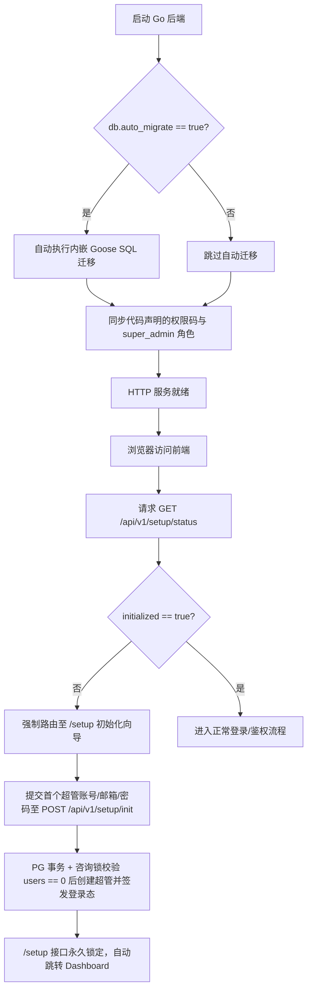

# 产品需求文档（PRD）：Tianshu（天枢）全栈后台脚手架

| 属性 | 内容 |
| --- | --- |
| **项目名称** | Tianshu（天枢） |
| **仓库路径 / Go Module** | `TianShu`（单仓库 `server/` + `web/` 分离） |
| **产品形态** | 可直接运行的现代全栈后台管理脚手架（Starter Kit） |
| **文档状态** | 待确认（由设计访谈沉淀） |
| **更新日期** | 2026-11-25 |

---

## 1. 背景与产品目标

### 1.1 问题背景

在启动新的中后台管理系统项目时，团队或独立开发者每次都需要重复搭建登录鉴权、RBAC 权限控制、用户与角色管理、审计日志、文件存储、前端管理后台壳子、国际化以及 Docker 部署与工程规范。传统重型脚手架往往引入过多隐式黑盒、复杂代码生成器或大量无用 Demo 页面，导致后期业务改造困难、人机（人 + AI）协作摩擦大。

### 1.2 核心目标（Goals）

1. **开箱即用的现代底座**：提供基于 **Go（Gin + PostgreSQL + sqlc + pgx + Goose）** 与 **`satnaing/shadcn-admin`（Vite + React + TypeScript + TanStack Router/Query）** 的完整可运行、前端可嵌入单二进制部署的后台基座。
2. **零命令行、零默认密码的首次启动体验**：启动服务后自动建表同步权限，首次打开浏览器即进入 Web 初始化向导（`/setup`）创建首个超级管理员并直接登录。
3. **干净、强类型、无黑盒的工程体验**：SQL 优先（`sqlc`）、TOML 强类型配置与语言包、显式手动依赖注入、模块化单体组织、极简 REST 错误结构。
4. **前后端协作双语国际化**：前端支持中英文无缝切换并通过 `Accept-Language` 联动后端翻译错误提示、表单校验与权限元数据，避免两端重复维护文案。
5. **人机协作规范治理**：内置纯文本 **Mini-trellis`.trellis/`）** 分层规范、路径触发规则与 Verify 门禁，确保开发者与 AI 按同一套标准扩展业务模块。

### 1.3 明确的非目标（Non-Goals）

以下能力**明确不纳入**本脚手架范围，以保持架构精炼克制：

- 不内置重型 CRUD / 反向读表代码生成器；
- 不采用 OpenAPI 双向代码生成工具链（不引入 `oapi-codegen` / `orval` / Redocly）；
- 不内置定时任务调度器或异步消息队列（由具体业务按需选型接入）；
- 不做多数据库兼容（专注 PostgreSQL 单一数据库）；
- 不做 SaaS 多租户隔离或部门树数据权限（单租户架构）；
- 不保留 `shadcn-admin` 原生无关静态 Mock Demo 页面（Tasks / Chats / Apps / Clerk / Help Center 等）；
- 仓库不强绑定特定 AI 宿主插件文件（仅提交纯文本 `.trellis/`）。

---

## 2. 目标用户与典型场景

| 角色 | 典型使用场景 | 核心诉求 |
| --- | --- | --- |
| **应用开发者 / 技术负责人** | 克隆 `tianshu` 启动新后台项目，按规范快速新增业务模块并上线 | 目录清晰、本地一条命令跑起来、生产 Docker 单镜像现成可用（Nginx 可选）、易于改名和二次开发 |
| **AI 编程助手** | 依据 `.trellis/` 规范与现有模块范例，协同完成新表迁移、后端模块与前端 CRUD 页面开发 | 分层 Specs，Verify 门禁可自动校验修改正确性 |
| **系统超级管理员** | 首次部署后通过 Web 向导初始化系统，随后管理用户、角色权限、文件并审查审计日志 | 初始化安全无默认弱口令、权限配置直观、支持多设备会话踢下线与中英双语切换 |
| **普通后台运营/成员** | 按自身被授予的角色权限登录后台，查看仪表盘、操作被授权模块并管理个人账户设置 | 仅看到有权限的菜单和按钮、错误提示清晰自然、会话过期可无感续期 |

---

## 3. 系统架构与核心机制

### 3.1 总体架构

- **仓库布局**：单仓库双目录物理分离——`server/`（Go 服务，内含 REST API 与前端静态资源嵌入）与 `web/`（React SPA 源码），外加根目录 `Makefile`、`server/Makefile`、`docker-compose.yml`、`docker-compose.prod.yml` 与 `.trellis/`。
- **部署模式**：**前端构建产物通过 Go `embed` 嵌入 server 二进制，单进程单镜像部署**。生产环境由 Go 直接提供 SPA 静态资源与 History Fallback；Nginx 仅作为可选的 TLS/边缘缓存/反向代理层，不再托管 `web/dist`。
- **前端嵌入**：`web/` 执行 `pnpm build` 生成 `web/dist`，由 `server/Makefile` 复制到 `server/internal/webui/dist` 后参与 `go build`。Go 的 `//go:embed` 不能引用 `../web/dist`，复制步骤是构建契约的一部分；`internal/webui/dist/.gitkeep` 保证无前端产物时 `go test` / `go build` 仍可编译，运行时缺少 `index.html` 返回明确错误。
- **模块化单体（Backend）**：Go 后端划分为 `internal/platform/*`（横切基础能力）与 `internal/modules/*`（按 `identity`、`access`、`auth`、`audit`、`files`、`dashboard`、`setup` 等业务域纵向切分的独立模块，其中 `identity` 合并原 user/profile、`access` 合并原 rbac/role），通过 `internal/app` 进行显式手动依赖注入与路由装配。

### 3.2 Web 首次初始化机制（Setup Wizard）



### 3.3 双 Token 认证与会话轮换机制

- **密码哈希**：使用 `argon2id` 哈希存储用户密码，严禁明文或弱哈希。
- **Access Token（短效 JWT，默认 15 分钟）**：仅由前端保存在内存状态（Zustand）中，通过 `Authorization: Bearer <token>` 传递，绝不写入 `localStorage`。
- **Refresh Token（长效高熵随机令牌，默认 7 天）**：后端仅在 `user_sessions` 表存储 SHA-256 哈希值，通过 `HttpOnly; Secure(生产); SameSite=Lax; Path=/api/v1/auth` Cookie 下发。
- **无感刷新与盗用检测**：
  - 前端遇到 `401`（非登录/刷新接口）时自动并发合并调用一次 `POST /api/v1/auth/refresh`，成功后重放原请求；刷新失败则清空内存登录态并跳转 `/sign-in`。
  - 每次刷新执行 Token 轮换（将旧哈希写入独立 `refresh_token_history` 表、在 `user_sessions` 写入新哈希），支持 30–60 秒并发刷新幂等宽限期；若检测到超出宽限期的任意代际已作废旧令牌被再次提交，立即吊销关联会话并记录安全审计事件。

### 3.4 声明式权限码 RBAC（单租户）

- **声明与同步**：权限码以常量形式在 Go 代码中声明，按标准动作细粒度拆分（`dashboard:read`、`users:read`、`users:create`、`users:update`、`users:delete`、`roles:read`、`roles:create`、`roles:update`、`roles:delete`、`menus:read`、`menus:create`、`menus:update`、`menus:delete`、`audit:read`、`files:read`、`files:upload`、`files:delete`），服务启动时自动 upsert 到 `permissions` 表。
- **超管保护**：系统内置 `super_admin` 角色（`is_system = true`），拥有全量权限，禁止删除该角色、禁止移除或禁用系统中最后一名活跃超级管理员。
- **缓存与失效**：用户聚合权限通过 `Cache` 接口缓存（默认进程内内存，配置 Redis 后自动切换）；当角色权限变更或用户角色变更时主动失效对应缓存。
- **前端联动**：登录后调用 `GET /api/v1/auth/me` 获取用户档案与 `permissions: string[]`，驱动侧边栏菜单过滤、TanStack Router 路由守卫与 `<PermissionGuard>` 操作按钮显隐。

### 3.5 前后端协作国际化（i18n）

- **默认与支持语言**：默认 `zh-CN`，支持 `en-US` 双语切换。
- **职责边界**：
  - **前端（`react-i18next`）**：管理全部界面静态文案（导航、按钮、表头、表单标签、弹窗标题、空状态），并在 HTTP 客户端拦截器中为所有请求自动附带 `Accept-Language: <lang>`；切换语言时自动失效依赖后端本地化文案的查询缓存（如权限目录）。
  - **后端（`internal/platform/i18n` + 模块自治语言包）**：采用**平台基础包 + 模块自治包**分层内嵌——`internal/platform/i18n` 仅内嵌全站通用错误与参数校验模板，各 `internal/modules/*` 各自通过 `go:embed` 内嵌本模块的 `locales/zh-CN.toml` 与 `locales/en-US.toml`，启动时由 `internal/app` 显式注册并聚合至统一 `i18n.Bundle`（重名 Key 立即报错退出）；由 `Locale` 中间件解析 `Accept-Language` 注入 `context.Context`，统一翻译：
    1. 业务错误响应中的 `message`；
    2. 请求参数校验失败时的字段级 `errors[].message`；
    3. 声明式权限码名称/描述与系统内置角色名称。
  - **业务数据**：用户自主录入的数据（用户名、昵称、自定义角色备注等）保持原样存储和返回，不做多语言表。

### 3.6 API 与极简错误规范

- **统一前缀**：业务接口统一挂在 `/api/v1/*`，探针接口为 `/healthz`（进程存活）与 `/readyz`（PostgreSQL 连通性校验）。
- **响应头**：所有 API 响应（含错误响应）必须包含 `X-Request-Id` 响应头，并与后端 `slog` 日志字段关联；嵌入式静态资源不必强制携带。
- **成功响应**：使用标准 HTTP 状态码（`200` / `201` / `204`），直接返回业务对象；分页列表统一返回：

  ```json
  {
    "items": [],
    "total": 100,
    "page": 1,
    "pageSize": 20
  }
  ```

- **错误响应**：配合语义化 HTTP 状态码（`400` / `401` / `403` / `404` / `409` / `413` / `422` / `429` / `500` / `503`），JSON 载荷保持极简：

  ```json
  // 普通错误（HTTP 401）
  {
    "code": "AUTH_INVALID_CREDENTIALS",
    "message": "用户名或密码错误"
  }

  // 字段校验错误（HTTP 422，errors 仅在参数校验失败时返回）
  {
    "code": "VALIDATION_FAILED",
    "message": "请求参数校验失败",
    "errors": [
      { "field": "email", "message": "请输入有效的邮箱地址" }
    ]
  }
  ```

- **请求 ID 位置**：`request_id` 只通过 `X-Request-Id` 响应头传递，错误体不重复携带；前端 HTTP 客户端把该头写入 `ApiError.requestId`，审计日志与响应头保持一致。

---

## 4. 功能模块详细需求与验收标准

### M1：首次初始化向导（Setup）

- **核心功能**：
  - `GET /api/v1/setup/status`：公开只读接口，返回 `{ initialized: boolean }`。
  - `POST /api/v1/setup/init`：仅在未初始化状态可用，免令牌极简向导，接收 `username`、`email`、`displayName`、`password`（8–128 字符），经数据库咨询锁串行化创建首个活跃用户并绑定 `super_admin` 角色；同时支持通过环境变量 `TIANSHU_ADMIN_USERNAME` / `TIANSHU_ADMIN_EMAIL` / `TIANSHU_ADMIN_PASSWORD`（可选 `TIANSHU_ADMIN_DISPLAY_NAME`）在启动期无人值守自动初始化，适合容器与公网部署场景。
  - 前端 `/setup` 页面：当 `initialized === false` 时拦截登录及其他页面并自动引导至此；表单包含中英文切换、密码强度校验与提交后直达仪表盘。
- **验收标准**：
  - 全新空库启动后端后访问前端，自动跳转 `/setup`；
  - 并发提交两次 `POST /api/v1/setup/init`，仅一次成功，另一次返回 `409 SETUP_ALREADY_INITIALIZED`；
  - 初始化完成后再次访问 `/setup` 自动重定向至 `/sign-in` 或 `/`；调用初始化接口永久被拒绝。

### M2：认证与会话管理（Auth）

- **核心功能**：
  - `POST /api/v1/auth/login`：支持用户名或邮箱 + 密码登录，校验账户状态（禁用账号拒绝登录并提示），更新 `last_login_at`，记录登录成功/失败审计日志。
  - `POST /api/v1/auth/refresh`：读取 HttpOnly Cookie 校验并轮换 Refresh Token，返回新 Access Token。
  - `POST /api/v1/auth/logout`：吊销当前会话并清除 Refresh Cookie。
  - `GET /api/v1/auth/me`：返回当前用户资料、角色列表与扁平化权限码数组 `permissions`。
  - 前端 `/sign-in` 页面：复用并精简 `shadcn-admin` 登录界面，支持中英文切换、记住当前页回跳（`redirect` 参数）、展示后端本地化报错信息。
- **验收标准**：
  - 正确凭据登录成功并进入 Dashboard，浏览器 `localStorage` 中无敏感 Token；
  - 禁用用户登录返回 `403 AUTH_ACCOUNT_DISABLED` 及对应语言提示；
  - Access Token 失效后页面发起业务请求可自动静默刷新并成功返回，用户无感知；
  - 登出后刷新页面无法自动恢复登录态，原 Refresh Token 调用刷新返回 `401`。

### M3：仪表盘概览（Dashboard）

- **核心功能**：
  - `GET /api/v1/dashboard/summary`（需 `dashboard:read`）：从 PostgreSQL 真实聚合返回系统核心统计指标（用户总数/活跃数、角色数、文件总数与占用空间、近 7 天操作/登录趋势、最近审计活动列表）。
  - 前端 `/` 首页：基于 `shadcn-admin` Dashboard 视觉风格呈现真实统计卡片、趋势图表与近期审计动态，彻底移除原模板假数据与无用 Tab。
- **验收标准**：
  - 新增用户、上传文件或产生登录记录后，刷新仪表盘数据实时准确反映变化；
  - 无 `dashboard:read` 权限的用户访问时受权限守卫保护（提示无权限或跳转允许首页）。

### M4：用户管理（Users）

- **核心功能**：
  - `GET /api/v1/users`（`users:read`）：支持分页、关键词搜索（用户名/邮箱/昵称）、状态筛选（`active` / `disabled`）、角色筛选，返回用户信息、关联角色及审计字段（创建时间、创建人等）。
  - `POST /api/v1/users`（`users:create`）：创建新用户并分配初始角色，校验用户名与邮箱唯一性，写入 `created_by` / `updated_by` 与审计日志。
  - `GET /api/v1/users/:id`（`users:read`）：查询用户详情。
  - `PATCH /api/v1/users/:id`（`users:update`）：编辑用户基础资料、状态、重置密码及重新分配角色，更新 `updated_by`，角色变更时立即失效用户权限缓存；若禁用用户同时吊销其所有活跃会话。
  - `DELETE /api/v1/users/:id`（`users:delete`）：软删除用户（写入 `deleted_at` 并吊销其全部活跃会话，禁止删除自身、禁止删除最后一名超管）。
  - 前端 `/users` 页面：基于沉淀的通用 CRUD DataTable 构建，支持服务端分页/搜索/筛选、新增/编辑弹窗、状态切换、角色多选与二次确认删除，各操作按钮分别受对应细粒度权限码（`users:create` / `users:update` / `users:delete`）控制。
- **验收标准**：
  - 重复用户名/邮箱创建返回 `409` 及对应语言提示；
  - 禁用在线用户后，其会话被吊销且无法刷新续期；
  - 尝试删除自己或最后一名超级管理员被后端拒绝并返回明确业务错误码。

### M5：角色与权限管理（Roles & Permissions）

- **核心功能**：
  - `GET /api/v1/permissions`（`roles:read`）：返回全部声明式权限码目录（按模块分组，名称与描述根据 `Accept-Language` 实时翻译）。
  - `GET /api/v1/roles`（`roles:read`）：分页查询角色列表（含关联用户数、权限数、是否系统角色及审计字段）。
  - `POST /api/v1/roles`（`roles:create`）：新建自定义角色并勾选权限码集合。
  - `PATCH /api/v1/roles/:id`（`roles:update`）：修改角色信息与权限码集合（`super_admin` 禁止修改 code 或剥夺全量权限），变更后失效相关用户权限缓存。
  - `DELETE /api/v1/roles/:id`（`roles:delete`）：删除自定义角色（系统角色或仍绑定用户的角色按规则拒绝删除并返回清晰提示）。
  - 前端 `/roles` 页面：DataTable 列表 + 按模块分组的权限矩阵勾选弹窗。
- **验收标准**：
  - 切换前端语言（中 ↔ 英）后，权限矩阵中的权限名称与描述同步切换语言；
  - 为普通角色勾选或取消 `users:delete` / `users:update` 等细粒度权限后，该角色下用户的接口鉴权立即生效。

### M6：个人中心与系统设置（Profile & Settings）

- **核心功能**：
  - `GET /api/v1/profile` & `PATCH /api/v1/profile`：查看与修改当前用户昵称、邮箱与头像（对接文件模块）。
  - `PUT /api/v1/profile/password`：校验旧密码后修改新密码，并可选择吊销除当前设备外的其他活跃会话。
  - `GET /api/v1/profile/sessions` & `DELETE /api/v1/profile/sessions/:id`：查看当前账号所有活跃设备会话（IP、User-Agent、最近使用时间、标记“当前设备”），支持踢出指定会话。
  - 前端 `/settings` 模块：对接 `shadcn-admin` 设置布局，提供**个人资料**、**安全与密码**、**活跃会话管理**与**外观/语言偏好**（亮暗主题 + 中英切换）。
- **验收标准**：
  - 改密时旧密码错误返回 `400/401` 本地化提示；改密成功后可使用新密码重新登录；
  - 在活跃会话页踢出另一设备会话后，被踢设备的下次刷新或登出校验立即失效。

### M7：审计与登录日志（Audit Logs）

- **核心功能**：
  - 统一审计记录能力：在登录（成功/失败）、登出、Setup 初始化、用户增删改、角色增删改、改密、文件上传/删除等关键写操作中，记录 `actor_id`、`actor_username`、`action`、`resource`、`resource_id`、`status`、`ip_address`、`user_agent`、`request_id` 与结构化 `metadata (jsonb)`。
  - `GET /api/v1/audit-logs`（`audit:read`）：支持按操作人、动作类型、资源类型、结果状态、时间范围分页筛选查询。
  - 前端 `/audit-logs` 页面：只读审计表格 + 详情抽屉展示完整 `metadata` JSON 与 `request_id`。
- **验收标准**：
  - 所有关键写操作与登录尝试均能落库审计，且 `request_id` 与后端响应头 `X-Request-Id` 及日志一致；
  - 日志表严禁提供修改或删除 API。

### M8：文件上传与存储抽象（Files）

- **核心功能**：
  - 后端 `internal/platform/storage` 抽象统一 `Storage` 接口（`Put`、`Get`、`Delete`、`Stat`），内置两种驱动并通过 `config.toml` 切换：
    - `local`：本地磁盘目录存储（默认，零外部服务依赖即可运行）；
    - `s3`：兼容 AWS S3 / MinIO 对象存储。
  - `POST /api/v1/files`（`files:upload` 或头像上传专用许可）：multipart 上传，校验文件大小上限（通用默认 10 MiB 可配置，头像 2 MiB）与内容嗅探 MIME 白名单（图片 `jpeg/png/webp/gif` 且禁用 `image/svg+xml`、文档 `pdf/txt/csv/docx/xlsx/pptx` 强制附件下载），头像上传执行纯 Go 重编码缩放与去 EXIF，计算 SHA-256，持久化至存储驱动并写入 `files` 元数据表。
  - `GET /api/v1/files`（`files:read`）：分页查询文件列表（支持按文件名、MIME 类型筛选）。
  - `GET /api/v1/files/:id/content`（鉴权下载/预览，头像可受控访问）：流式输出文件内容与正确 `Content-Type` / `Content-Disposition`。
  - `DELETE /api/v1/files/:id`（`files:delete`）：删除存储对象及元数据记录。
  - 前端 `/files` 页面：拖拽/按钮上传、文件列表、图片预览、下载与删除。
- **验收标准**：
  - 默认 `local` 模式下上传、预览、下载、删除全链路畅通；
  - 启用 `docker compose --profile minio up -d` 并切换配置为 `s3` 驱动后，业务代码零改动即可读写 MinIO；
  - 超过大小限制或非法类型文件返回清晰 `400/413` 错误码与多语言提示。

### M9：前端 `shadcn-admin` 底座改造与通用组件

- **裁剪清理**：彻底移除 `satnaing/shadcn-admin` 中的静态 Mock 数据与无关页面（Tasks、Chats、Apps、Clerk、Help Center 等），保留干净布局壳子、主题切换、命令面板（Command Menu，适配真实菜单与权限）、错误页（401/403/404/500）。
- **通用 CRUD DataTable**：沉淀可复用的服务端驱动 `DataTable` 组件（统一封装分页条、关键词搜索、下拉筛选项、列显隐、加载骨架屏与空态），在 Users、Roles、Audit Logs、Files 中一致复用，并作为后续新业务页范例。
- **权限与路由守卫**：提供 `<PermissionGuard>` 组件与路由 `beforeLoad` 鉴权检查，未登录跳转 `/sign-in`、未初始化跳转 `/setup`、无权限展示 `403` 页。

---

## 5. 数据模型规格（PostgreSQL + UUIDv7）

### 5.1 统一建表规范

1. 所有主键统一使用应用层生成的 **UUIDv7**（PostgreSQL 原生 `UUID` 类型）。
2. 所有时间字段统一使用 `TIMESTAMPTZ NOT NULL DEFAULT now()`。
3. **标准审计四字段**：所有核心实体表与未来新增业务表默认包含 `created_at`、`updated_at`、`created_by`、`updated_by`，其中 `created_by` / `updated_by` 为可空 `UUID REFERENCES users(id) ON DELETE SET NULL`。

### 5.2 核心表清单

| 表名 | 用途 | 核心列 |
| --- | --- | --- |
| `users` | 系统用户 | `id`, `username (UNIQUE WHERE deleted_at IS NULL)`, `email (UNIQUE WHERE deleted_at IS NULL)`, `password_hash`, `display_name`, `avatar_file_id`, `status`, `last_login_at`, `deleted_at`, `created_by`, `updated_by`, `created_at`, `updated_at` |
| `roles` | 角色定义 | `id`, `code (UNIQUE)`, `name`, `description`, `name_key`, `description_key`, `is_system`, `created_by`, `updated_by`, `created_at`, `updated_at`（系统内置角色按 key 翻译，自定义角色保留原始文本） |
| `permissions` | 声明式权限码目录 | `code (PK)`, `module`, `name_key`, `description_key`, `updated_at`（按 key 从语言包解析双语文案） |
| `user_roles` | 用户-角色关联 | `user_id (FK CASCADE)`, `role_id (FK CASCADE)`, `PK(user_id, role_id)` |
| `role_permissions` | 角色-权限关联 | `role_id (FK CASCADE)`, `permission_code (FK CASCADE)`, `PK(role_id, permission_code)` |
| `menus` | 动态菜单与按钮权限树 | `id`, `parent_id (FK RESTRICT)`, `type (directory/menu/button)`, `code (UNIQUE)`, `title`, `title_key`, `path`, `icon`, `permission_code (FK SET NULL)`, `sort_order`, `visible`, `status`, `is_system`, `created_by`, `updated_by`, `created_at`, `updated_at` |
| `user_sessions` | Refresh Token 会话 | `id`, `user_id (FK CASCADE)`, `refresh_token_hash (UNIQUE)`, `user_agent`, `ip_address`, `expires_at`, `revoked_at`, `last_used_at`, `created_at` |
| `refresh_token_history` | Refresh Token 轮换历史 | `token_hash (PK)`, `session_id (FK CASCADE)`, `replaced_at`, `expires_at` |
| `audit_logs` | 审计与登录日志 | `id`, `actor_id`, `actor_username`, `action`, `resource`, `resource_id`, `status`, `ip_address`, `user_agent`, `request_id`, `metadata (JSONB)`, `created_at` |
| `files` | 上传文件元数据 | `id`, `uploader_id (FK SET NULL)`, `storage_driver`, `object_key`, `original_name`, `mime_type`, `size_bytes`, `sha256`, `created_at` |

---

## 6. 非功能性需求、工程化与规范治理

### 6.1 配置、日志与文档

- **配置文件**：采用 **TOML**（`server/configs/config.example.toml` 仅作模板；运行时支持 `-config` / `TIANSHU_CONFIG` 显式指定，未指定时按 `configs/config.toml` → `config.toml` → `configs/config.local.toml` → `config.local.toml` 叠加加载），使用 `koanf` 加载并支持 `TIANSHU_*` 环境变量覆盖，启动时校验必填项（如生产环境禁止默认 JWT Secret）。
- **结构化日志**：基于 Go 标准库 `log/slog`，开发环境输出彩色可读文本，生产环境输出 JSON，所有请求日志自动携带 `request_id`、耗时、状态码、路径与客户端 IP。
- **接口文档**：通过 `swag` 注释生成 OpenAPI/Swagger JSON，开发环境暴露 `/swagger` 或 `/docs`（Scalar/Swagger UI）供本地调试，生产环境默认关闭。
- **优雅停机**：监听 `SIGINT` / `SIGTERM`，在超时窗口内平滑关闭 HTTP Server、PostgreSQL 连接池与缓存连接。

### 6.2 安全性基线

- 密码采用 `argon2id` 哈希；Refresh Token 仅存哈希值与 `HttpOnly` Cookie；
- 所有敏感输入执行严格结构体校验与 `sqlc` 参数化查询（杜绝 SQL 注入）；
- 内置合理 CORS 白名单配置、请求体大小限制、Recover 中间件（防止 panic 泄露堆栈到客户端）；
- 文件上传校验大小与 MIME、拒绝路径穿越（存储对象 Key 统一使用 UUID 生成）；
- 嵌入式前端静态资源设置 `nosniff`、CSP、`Referrer-Policy` 等安全响应头；`index.html` 不强缓存，带 hash 的 `assets/*` 长缓存。

### 6.3 开发、部署与 trellis 治理交付物

- **本地开发环境**：`docker-compose.yml` 默认启动 PostgreSQL 17，提供 `--profile minio`（MinIO）与 `--profile redis`（Redis）按需开启；根 `Makefile` 提供 `dev`、`build`、`test`、`lint`、`docker` 等入口，`server/Makefile` 负责 `web-build`、`web-embed`、`server-build`、`test`、`lint`、`sqlc`、`swagger` 等 Go 侧目标；后端支持 `air` 热重载，前端 `pnpm dev` 与 Go API 通过 Vite proxy 联调。
- **生产部署套件**：`server/Dockerfile` 多阶段构建（Node 构建 `web/dist` → 复制到 `server/internal/webui/dist` → Go 编译单二进制；build context 为仓库根，执行 `docker build -f server/Dockerfile .`）；`docker-compose.prod.yml` 默认只启动 app（可选 `--profile nginx` 启用 TLS/边缘代理）；`deploy/nginx/default.conf` 仅作为可选反向代理配置，不再托管静态资源。
